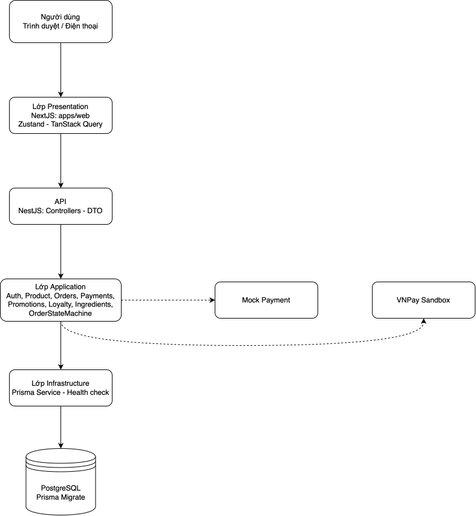

# Task 3.1 – Thiết kế kiến trúc BrewLite (kiến trúc phân lớp)

> **Phạm vi:** Đây là tài liệu cho **Task 3.1 – Phương pháp và quyết định kiến trúc**. BrewLite là ứng dụng đặt đồ uống, thanh toán không tiền mặt và nhận tại quầy. Nội dung dưới đây dựa trên mã nguồn của repository `minhhhao12/brewlite` tại ngày **14/11/2026**. Không mô tả các tính năng chưa triển khai như thể đã có.

## 1. Phương pháp kiến trúc được chọn

BrewLite sử dụng **kiến trúc phân lớp (Layered Architecture)** kết hợp **modular monolith** ở backend:

- **Frontend:** Next.js (React, TypeScript), giao diện dành cho trình duyệt/thiết bị di động.
- **Backend:** Một ứng dụng NestJS, chia module theo domain (nghiệp vụ).
- **Dữ liệu:** PostgreSQL; NestJS truy cập qua Prisma ORM.
- **Thanh toán mô phỏng:** Xử lý nội bộ trong `PaymentsService`, **không phải microservice/ứng dụng mạng độc lập**.
- **Thành phần dùng chung:** Logging, health check và quản lý cấu hình thuộc ứng dụng backend.

**Lý do chọn:** Đồ án có phạm vi tương đối nhỏ, cần luồng đặt đơn/thanh toán rõ ràng, dễ phát triển, kiểm thử và triển khai. Phân lớp giúp tách giao diện, xử lý nghiệp vụ và truy cập dữ liệu, tránh độ phức tạp của microservices.

## 2. Sơ đồ kiến trúc



**Luồng chính:** Người dùng → Next.js → REST/JSON → NestJS Controller → Service + quy tắc nghiệp vụ → Prisma → PostgreSQL. Khi thanh toán mô phỏng, `PaymentsService` xử lý kết quả trong chính backend rồi cập nhật dữ liệu giao dịch. Logging, health check và config hỗ trợ backend

## 3. Các lớp và thành phần

| Lớp | Công nghệ / vị trí trong repo | Trách nhiệm |
| --- | --- | --- |
| **Presentation (Frontend)** | `apps/web/` – Next.js App Router | Hiển thị menu, giỏ hàng, checkout, đơn hàng; gọi API. |
| **Interface (Backend)** | `apps/api/src/**/**.controller.ts`, DTO, Guard, Filter | Nhận HTTP request, kiểm tra dữ liệu/xác thực, trả JSON và mã lỗi. |
| **Application & Domain** | `apps/api/src/**/**.service.ts`, `domain/` | Tạo đơn, tính toán và kiểm tra quy tắc nghiệp vụ; quản lý trạng thái đơn/thanh toán. |
| **Infrastructure / Data** | `apps/api/src/prisma/`, `apps/api/prisma/` | Prisma Client, truy vấn PostgreSQL, transaction và migration. |
| **Cross-cutting** | `apps/api/src/config/`, `health/`, NestJS `Logger` | Cấu hình, kiểm tra tình trạng hệ thống, ghi log. |

Đây là các **lớp logic**. Backend chỉ là **một ứng dụng NestJS**, không triển khai mỗi lớp thành một server riêng.

### 3.1. Frontend Next.js/PWA

- Dùng **Next.js App Router** với các trang như `/`, `/products/[id]`, `/cart`, `/checkout`, `/orders`, `/login`, `/register`.
- Client gọi REST API bằng `apps/web/lib/api.ts`; giỏ hàng dùng Zustand; dữ liệu truy vấn có TanStack Query.
- Có **Web App Manifest** tại `apps/web/app/manifest.ts` (`display: standalone`, tên, màu chủ đề), tạo nền tảng PWA.
- **Giới hạn hiện tại:** Chưa có service worker/offline cache hoàn chỉnh; vì vậy chỉ mô tả là **PWA mức cơ bản**, không khẳng định website đặt đơn được khi offline.

### 3.2. Backend NestJS chia theo module/domain

Các module thực tế tại `apps/api/src/`:

| Module | Chức năng |
| --- | --- |
| `auth` | Đăng ký, đăng nhập, xác thực JWT. |
| `products` | Menu, sản phẩm và tùy chọn. |
| `orders` | Tạo/hủy/theo dõi đơn, quản lý trạng thái đơn. |
| `payments` | Thanh toán mock hoặc tích hợp VNPay Sandbox khi cấu hình. |
| `promotions` | Kiểm tra, áp dụng khuyến mãi. |
| `loyalty` | Xử lý điểm tích lũy. |
| `ingredients` | Quản lý nguyên liệu và tồn kho liên quan. |
| `health`, `prisma` | Kiểm tra hệ thống và truy cập dữ liệu. |

**Quy tắc phụ thuộc:** Controller nhận request → Service thực hiện use case → Domain policy/state machine kiểm tra quy tắc → Prisma đọc/ghi dữ liệu. Những quy tắc như `OrderStateMachine` nằm trong `orders/domain/` để tránh rải logic trạng thái khắp các controller.

### 3.3. PostgreSQL và cơ chế migration

- Schema chính: `apps/api/prisma/schema.prisma`.
- Các phiên bản migration SQL: `apps/api/prisma/migrations/`.
- Prisma Client là lớp truy cập dữ liệu từ NestJS tới PostgreSQL.
- Dùng **transaction**, ràng buộc **unique** và kiểm tra xung đột khi xử lý đơn/thanh toán. Code tạo đơn hiện dùng **Serializable transaction + optimistic locking**, không nên ghi là mọi thao tác đều dùng `SELECT ... FOR UPDATE`.

Chạy từ **thư mục gốc repository**:

```bash
pnpm prisma:generate       # Tạo Prisma Client
pnpm db:migrate            # Phát triển local: tạo/áp dụng migration
pnpm db:migrate:deploy     # Áp dụng migration đã commit (deployment)
```

Quy trình: sửa `schema.prisma` → tạo migration ở môi trường phát triển → commit file SQL migration → áp dụng migration ở môi trường cần chạy. **Không tự ý chạy `db:reset` với database có dữ liệu cần giữ.**

### 3.4. Dịch vụ thanh toán mô phỏng (Mock Payment)

1. Người dùng tạo đơn trên frontend.
2. Frontend gửi `POST /payments` cùng JWT và `Idempotency-Key`.
3. `PaymentsService` kiểm tra đơn thuộc người dùng, trạng thái đơn và số tiền lưu trên server.
4. Khi `PAYMENT_PROVIDER=mock` (mặc định), backend mô phỏng **thành công** hoặc **thất bại**. Có `simulateFailure` dành cho demo ngoài môi trường production.
5. Backend lưu kết quả `Payment`, cập nhật `Order` theo `OrderStateMachine` và trả kết quả cho frontend. Idempotency giúp giảm nguy cơ tạo thanh toán trùng khi gửi lại request.

**Quan trọng:** Mock hiện được viết **trực tiếp trong** `apps/api/src/payments/payments.service.ts`, không có `MockPaymentGateway` class/job đối soát riêng. Repo có thêm VNPay Sandbox (Return-only) để mở rộng.

### 3.5. Logging, health check và quản lý cấu hình

| Yêu cầu | Cách BrewLite hiện thực | Giới hạn |
| --- | --- | --- |
| **Logging** | `Logger` mặc định của NestJS trong backend, ghi hoạt động/lỗi. | Chưa triển khai logger JSON có `requestId` đồng nhất. |
| **Health check** | `GET /health` kiểm tra API còn chạy; `GET /health/ready` truy vấn `SELECT 1` để xác nhận kết nối PostgreSQL (lỗi trả 503). | Readiness phụ thuộc database đang chạy. |
| **Config** | `@nestjs/config`, `ConfigModule.forRoot({validate: validateEnv})`, kiểm tra biến môi trường lúc khởi động (`apps/api/src/config/env.validation.ts`). | `LOG_LEVEL` được validate nhưng chưa điều khiển toàn bộ logger. |

Các biến tiêu biểu: `DATABASE_URL`, `JWT_SECRET`, `PORT`, `CORS_ORIGIN`, `LOG_LEVEL`, `PAYMENT_PROVIDER`. File `.env.example` chỉ để hướng dẫn;

## 4. Ưu điểm, hạn chế và trade-off

| Quyết định | Ưu điểm | Hạn chế / trade-off chấp nhận |
| --- | --- | --- |
| **Kiến trúc phân lớp + NestJS modular monolith** | Ít thành phần triển khai; dễ đọc, kiểm thử và dùng chung transaction. | Các module cùng triển khai và scale với một API; cần giữ ranh giới module. |
| **Next.js + PWA cơ bản** | Giao diện web mobile-first, không cần xây app native. | PWA chưa có offline hoàn chỉnh, chưa thay thế được ứng dụng native. |
| **PostgreSQL + Prisma Migrate** | Dữ liệu quan hệ, giao dịch ACID, schema/migration có phiên bản. | Cần quản lý migration cẩn thận, tránh thay đổi schema gây lỗi dữ liệu. |
| **Mock Payment nội bộ** | Demo và test kết quả nhanh, không phát sinh tiền thật. | Không mô phỏng đầy đủ kết nối ngân hàng/webhook; không dùng để thanh toán thật. |
| **Nest Logger + Health + Config** | Đủ quan sát và kiểm tra lỗi cơ bản, ít dependency. | Chưa có distributed tracing hay structured logging chuyên sâu. |
| **Monorepo pnpm** | Đồng bộ web/API/docs trong một repository. | CI và phụ thuộc giữa các workspace có thể phức tạp khi dự án lớn. |

**Đánh đổi tổng thể:** Nhóm ưu tiên **đơn giản, đúng dữ liệu, dễ demo và bảo trì** thay vì microservices, kiến trúc phân tán hoặc hạ tầng quan sát phức tạp. Đây là lựa chọn phù hợp với phạm vi đồ án BrewLite, nhưng nếu số lượng người dùng và đội phát triển tăng mạnh thì có thể cần phân tách dịch vụ hoặc bổ sung hạ tầng.

## 5. Các quyết định kiến trúc (ADR)

Các quyết định quan trọng đã được ghi thành các file ngắn trong `docs/architecture/adr/`:

- [ADR-001 – Monorepo pnpm](./adr/001-monorepo.md)
- [ADR-002 – Kiến trúc phân lớp và NestJS module/domain](./adr/002-modular-monolith-nestjs.md)
- [ADR-003 – Next.js/PWA](./adr/003-nextjs-pwa.md)
- [ADR-004 – PostgreSQL + Prisma Migrate](./adr/004-postgresql-prisma-migration.md)
- [ADR-005 – Thanh toán mô phỏng](./adr/005-mock-payment-adapter.md)
- [ADR-006 - Thanh toán quá VNPay Sandbox](./adr/006-vnpay-sandbox.md)
- [ADR-007 – Logging, Health Check, Config](./adr/007-logging-health-config.md)
- [ADR-008 - Nền tàng Deploy](./adr/008-deploy-platform.md)

