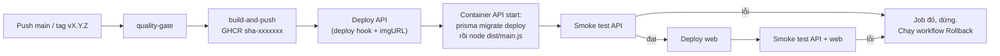

# Runbook deploy production, smoke test và rollback (CV20 – Task 5.3)

Tài liệu này hướng dẫn đưa BrewLite lên Render, kiểm tra sau deploy và quay lui khi lỗi. Quyết định nền tảng: [ADR-006](./architecture/adr/006-deployment-platform.md). Pipeline build image: [`cd-pipeline.md`](./cd-pipeline.md).

> Trạng thái: các file trong repo (workflow, script, entrypoint, `render.yaml`) đã sẵn sàng. **URL production chỉ có sau khi bạn tạo dịch vụ Render ở mục 2.** Không ghi URL giả vào tài liệu.

## 1. Tổng quan luồng



Mỗi lần deploy ghim đúng image `sha-<7 ký tự commit>`, không dùng `latest`, nên biết chính xác bản nào đang chạy và quay về được.

## 2. Thiết lập một lần

1. **GHCR public**: sau lần CD đầu tiên, vào repo → Packages → `api` và `web` → Package settings → đổi *Visibility* thành Public (để Render kéo image không cần đăng nhập). Nếu giữ private, thêm GHCR credential (token `read:packages`) trong Render → Account Settings → Registry Credentials.
2. **Render Postgres**: New → PostgreSQL, ghi nhận *Internal Database URL*.
3. **Render Web Service cho API**: New → Web Service → *Existing image* → `ghcr.io/<owner>/<repo>/api:latest` (chữ thường). Health Check Path `/health`. Biến môi trường:

   | Biến | Giá trị |
   | :--- | :--- |
   | `NODE_ENV` | `production` |
   | `DATABASE_URL` | Internal Database URL ở bước 2 |
   | `JWT_SECRET` | chuỗi ngẫu nhiên ≥ 32 ký tự (**secret**) |
   | `CORS_ORIGIN` | URL HTTPS của web (điền sau bước 4) |
   | `WEB_BASE_URL` | như `CORS_ORIGIN` |
   | `PAYMENT_PROVIDER` | `mock` |
   | `RUN_MIGRATIONS` | `true` |

4. **Render Web Service cho web**: tương tự với image `.../web:latest`, Health Check Path `/`. Sau khi có URL web, quay lại API điền `CORS_ORIGIN`/`WEB_BASE_URL`.
5. **Build web trỏ đúng API**: `NEXT_PUBLIC_API_URL` được nhúng lúc build. Trong GitHub → Settings → Secrets and variables → Actions → **Variables** đặt `NEXT_PUBLIC_API_URL` = URL HTTPS của API, rồi chạy lại CD để build lại image web.
6. **Deploy Hook**: ở mỗi service Render → Settings → Deploy Hook, copy URL.
7. **GitHub Environment `production`** (Settings → Environments), thêm:

   | Loại | Tên | Giá trị |
   | :--- | :--- | :--- |
   | Secret | `RENDER_DEPLOY_HOOK_API_URL` | hook của API |
   | Secret | `RENDER_DEPLOY_HOOK_WEB_URL` | hook của web |
   | Variable | `API_URL` | URL HTTPS của API, không có `/` cuối |
   | Variable | `WEB_URL` | URL HTTPS của web |

   Hook URL chứa khóa bí mật, chỉ để ở Secret, không dán vào chat hay commit. Có thể bật *Required reviewers* cho environment nếu muốn duyệt tay trước khi deploy.

Có thể dùng [`render.yaml`](../render.yaml) (Blueprint) thay cho bước 2–4; thay `OWNER/REPO` trước khi dùng.

> Chưa đặt đủ secret/variable ở bước 7 thì job `deploy` bỏ qua với cảnh báo, pipeline vẫn xanh.

## 3. Deploy

* Tự động: push `main` hoặc tag `vX.Y.Z`.
* Tay: Actions → *Continuous Delivery (CD)* → Run workflow.

Thứ tự: quality gate → build/push image → deploy API → smoke test API → deploy web → smoke test API + web. Lỗi ở bước nào thì dừng ở đó.

### Migration an toàn

* Chạy trong entrypoint của container API khi `RUN_MIGRATIONS=true`: `prisma migrate deploy` rồi mới `node dist/main.js`. Migration lỗi thì container thoát, Render giữ bản cũ đang chạy, không phục vụ traffic bằng schema dở dang.
* Chỉ chạy **một instance API** để tránh hai container migrate cùng lúc. Khi scale, chuyển migration sang bước riêng.
* Forward-only: không tự lùi migration. Xem mục 5.

## 4. Smoke test

Script [`scripts/smoke-test.sh`](../scripts/smoke-test.sh) kiểm tra:

| Kiểm tra | Điều kiện đạt |
| :--- | :--- |
| `GET /health` | HTTP 200, có `"status":"ok"` |
| `GET /health/ready` | HTTP 200, `"database":"up"` (kết nối được PostgreSQL) |
| `GET /products` | HTTP 200, trả danh sách JSON |
| `GET <WEB_URL>/` | HTTP 200, trả HTML |

Thử lại tối đa 30 lần cách 10 giây (Render cần thời gian kéo image và khởi động; gói free còn bị ngủ). Hết lượt vẫn lỗi thì thoát mã 1 và job đỏ (fail-fast).

Chạy tay trên máy:

```bash
bash scripts/smoke-test.sh https://<api>.onrender.com https://<web>.onrender.com
```

## 5. Rollback

### 5.1. Khi nào

Smoke test đỏ, hoặc sau deploy phát hiện lỗi nghiêm trọng (đăng nhập, đặt đơn, thanh toán hỏng).

### 5.2. Cách làm

1. Tìm tag bản ổn định trước đó: tab Packages của repo, hoặc lịch sử CD (tag `sha-xxxxxxx` hay `1.0.0`).
2. Actions → **Rollback production** → Run workflow → nhập `image_tag` (ví dụ `sha-1a2b3c4`).
3. Workflow deploy lại đúng image đó cho API và web, rồi tự chạy smoke test. Xanh nghĩa là đã quay về.

Cách dự phòng, không cần GitHub: Render Dashboard → service → Manual Deploy → *Deploy a specific image* → nhập `ghcr.io/<owner>/<repo>/api:<tag>` (làm tương tự cho web).

### 5.3. Với database

* Rollback chỉ đổi image, **không** lùi migration.
* Quy tắc để rollback an toàn: migration phải **tương thích ngược** (thêm cột/bảng nullable trước, xóa/đổi tên ở release sau). Bản code cũ chạy được trên schema mới.
* Migration phá hủy lỡ chạy: khôi phục từ backup của Render Postgres (kiểm tra gói đang dùng có backup không).

## 6. Diễn tập rollback (làm 1 lần để có minh chứng)

1. Ghi lại `sha` đang chạy tốt (A).
2. Push commit nhỏ để deploy bản B, chờ smoke test xanh.
3. Chạy **Rollback production** với `image_tag = sha-A`.
4. Xác nhận job xanh, mở web thấy bản A. Chụp màn hình các lần chạy Actions để nộp.

## 7. Minh chứng cần nộp

* Ảnh Actions: CD xanh (có job `deploy`, bước smoke test).
* URL web và API production, truy cập được qua HTTPS.
* Ảnh log smoke test đạt và log rollback.
* Ảnh Render Dashboard: service chạy image `sha-...`.

## 8. Giới hạn cần biết

* Smoke test ngay sau khi gọi hook có thể trúng instance cũ còn đang chạy rồi báo đạt sớm; `/health` chưa trả phiên bản. Muốn chắc hơn thì thêm phiên bản (SHA) vào `/health` rồi so sánh. Chưa làm.
* Render gói free: dịch vụ ngủ sau thời gian không dùng (cold start chậm) và database free có hạn dùng. Kiểm tra gói hiện hành trước khi nộp.
* Chưa có hoàn tác migration tự động và chưa có thông báo (Slack/email) khi deploy lỗi.
* VNPay trên production cần `PAYMENT_PROVIDER=vnpay` kèm các biến `VNPAY_*` và `VNPAY_RETURN_URL` trỏ vào API production; xem [`vnpay-sandbox.md`](./vnpay-sandbox.md). Mặc định runbook dùng `mock`.
