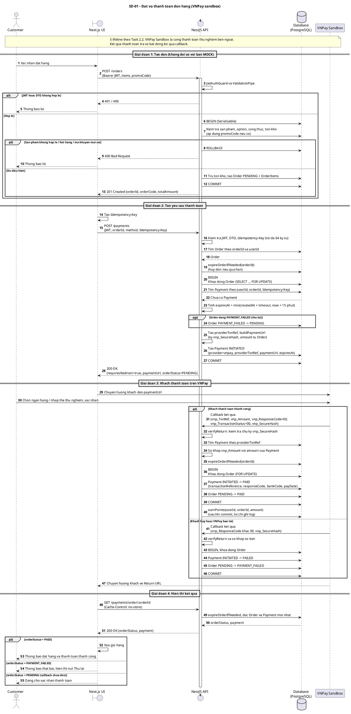
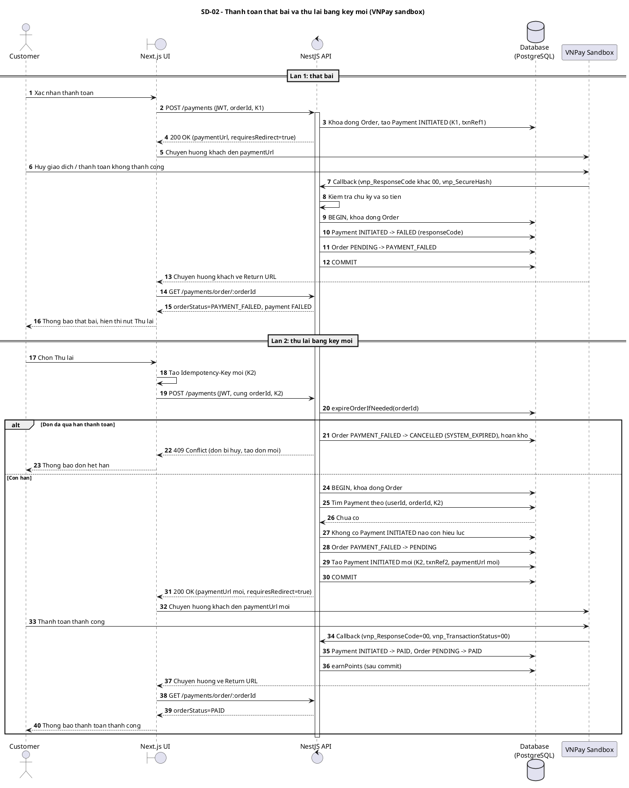
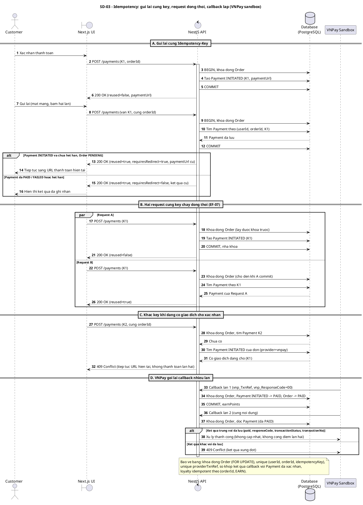
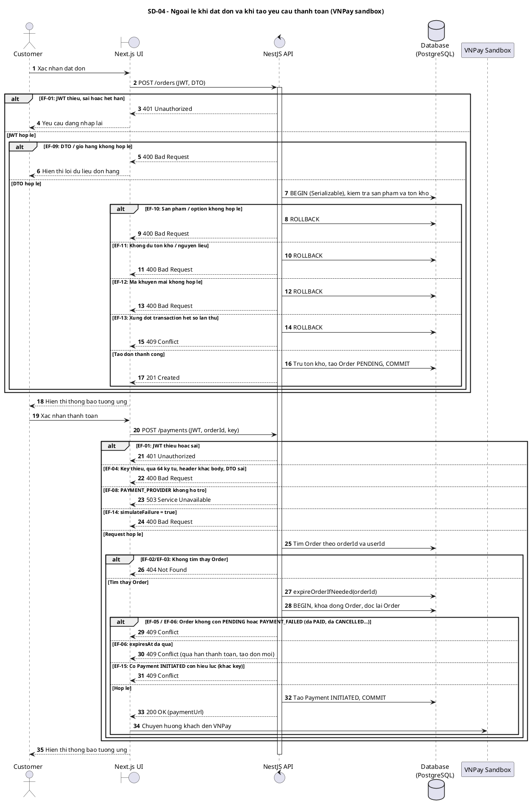
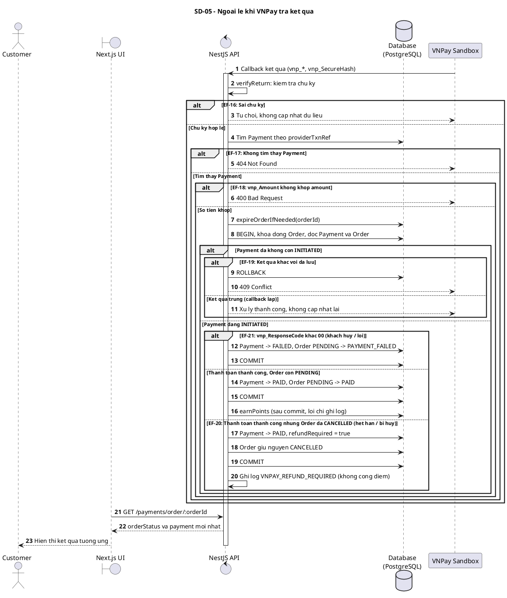

# Sequence Diagram: Đặt và thanh toán đơn hàng (VNPay sandbox)

Phạm vi: use-case **Đặt và thanh toán đơn hàng** (FR-03, FR-04, FR-05, FR-06, FR-08, FR-09, FR-10, NFR-02, NFR-05).

Năm lifeline theo Task 2.2: `Customer → Next.js UI → NestJS API → Database (PostgreSQL) → VNPay Sandbox`.
`VNPay Sandbox` thay cho `Payment Service (MOCK)` của bản trước. Nhánh MOCK vẫn còn trong code (khi `PAYMENT_PROVIDER=mock`) nhưng các sơ đồ dưới đây vẽ luồng `PAYMENT_PROVIDER=vnpay`.

**Cách render:** sao chép từng khối PlantUML vào https://www.plantuml.com/plantuml/ hoặc dùng extension PlantUML trong VS Code.

| Sơ đồ | Nội dung | Luồng trong đặc tả |
| :--- | :--- | :--- |
| SD-01 | Luồng tổng quát: đặt đơn, tạo URL VNPay, nhận kết quả | MF, AF-06 |
| SD-02 | Thanh toán thất bại và thử lại bằng key mới | AF-03 |
| SD-03 | Idempotency: gửi lại cùng key, request đồng thời, callback lặp | AF-04, EF-07 |
| SD-04 | Ngoại lệ khi đặt đơn và khi tạo yêu cầu thanh toán | EF-01 đến EF-06, EF-08 đến EF-15 |
| SD-05 | Ngoại lệ khi VNPay trả kết quả | EF-16 đến EF-20 |

## Những gì thay đổi so với bản MOCK

| Nội dung | Bản MOCK | Bản VNPay sandbox (theo code) |
| :--- | :--- | :--- |
| Kết quả thanh toán | Đồng bộ trong `POST /payments` | `POST /payments` chỉ tạo Payment `INITIATED` và trả `paymentUrl`. Kết quả về sau qua callback của VNPay |
| Payment `status` | `PAID`, `FAILED` | Thêm `INITIATED` |
| Nguyên nhân thất bại | `simulateFailure = true` | Mã phản hồi VNPay khác `00` (ví dụ khách hủy trên trang VNPay) |
| `simulateFailure` | Cho phép ngoài production | **Luôn bị từ chối (400)** khi dùng VNPay |
| Chống xử lý lặp | `updateMany` có điều kiện + unique key | Khóa dòng Order (`SELECT ... FOR UPDATE`) + unique key + so khớp kết quả callback |
| Giao dịch đang chờ | Không có | Đơn đang có Payment `INITIATED` còn hiệu lực thì tạo thêm bị 409 |
| Hết hạn thanh toán | Lazy expiry trong `POST /payments` | Lazy expiry cả khi tạo yêu cầu, khi nhận callback và khi đọc trạng thái |
| Thanh toán tiền về sau khi đơn đã hủy | Không có | Payment `PAID` với `refundRequired = true`, ghi log `VNPAY_REFUND_REQUIRED` |

---

## SD-01. Luồng tổng quát: đặt đơn, tạo URL VNPay, nhận kết quả

Truy vết: FR-03, FR-04, FR-05, FR-06, FR-08, FR-09, FR-10, NFR-02, NFR-05.

---

## SD-02. AF-03: Thanh toán thất bại và thử lại bằng key mới

Truy vết: FR-06, FR-08, NFR-05.

Thất bại do VNPay trả mã khác `00` (ví dụ khách hủy trên trang VNPay), không còn do `simulateFailure`. Thử lại phải dùng **Idempotency-Key mới (K2)** và tạo Payment `INITIATED` mới với `providerTxnRef` mới. Deadline thanh toán vẫn tính từ `createdAt` của đơn, không được gia hạn.

---

## SD-03. AF-04 và EF-07: Idempotency, request đồng thời, callback lặp

Truy vết: FR-06, NFR-05.

Cơ chế bảo vệ trong code VNPay: (1) khóa dòng Order bằng `FOR UPDATE` để các lần tạo thanh toán tuần tự hóa, (2) unique `(userId, orderId, idempotencyKey)` và `providerTxnRef`, (3) callback lặp được so khớp với kết quả đã lưu.

---

## SD-04. Ngoại lệ khi đặt đơn và khi tạo yêu cầu thanh toán

Truy vết: FR-04, FR-05, FR-06, FR-08, FR-09, NFR-02, NFR-05.

| Mã | Tình huống | Kết quả |
| :--- | :--- | :--- |
| EF-01 | Thiếu JWT hoặc token hết hạn/sai | 401 Unauthorized |
| EF-02, EF-03 | Đơn không tồn tại hoặc không thuộc người dùng | 404 (truy vấn theo `orderId` và `userId`) |
| EF-04 | Thiếu Idempotency-Key, quá 64 ký tự, header khác body, DTO sai | 400 |
| EF-05 | Đơn không ở `PENDING` hoặc `PAYMENT_FAILED` với key mới | 409 |
| EF-06 | Đơn chưa thanh toán quá hạn | Lazy expiry: đơn `CANCELLED` (`SYSTEM_EXPIRED`), hoàn kho, tạo thanh toán trả 409 |
| EF-08 | `PAYMENT_PROVIDER` khác `mock` và `vnpay` | 503 |
| EF-09 | Giỏ rỗng, số lượng sai, topping trùng, DTO sai | 400, không tạo đơn |
| EF-10 | Sản phẩm không tồn tại/không ACTIVE hoặc option không hợp lệ | 400, rollback |
| EF-11 | Không đủ tồn kho hoặc nguyên liệu | 400, rollback |
| EF-12 | Mã khuyến mãi không tồn tại hoặc không đủ điều kiện | 400, rollback |
| EF-13 | Xung đột transaction quá số lần thử | 409 |
| EF-14 | `simulateFailure = true` khi dùng VNPay (luôn bị chặn) | 400 |
| EF-15 | Đơn đang có giao dịch VNPay `INITIATED` còn hiệu lực, khác key | 409 |

---

## SD-05. Ngoại lệ khi VNPay trả kết quả

Truy vết: FR-06, FR-08, FR-10, NFR-02, NFR-05.

| Mã | Tình huống | Kết quả |
| :--- | :--- | :--- |
| EF-16 | Sai chữ ký `vnp_SecureHash` | Bị từ chối trong `verifyReturn`, không cập nhật Payment (mã lỗi và dạng phản hồi cho VNPay nằm ở `VnpayService`/`VnpayController`, chưa có file) |
| EF-17 | Không tìm thấy Payment theo `providerTxnRef` | 404 |
| EF-18 | `vnp_Amount` không khớp số tiền Payment | 400, không cập nhật |
| EF-19 | Kết quả callback lặp nhưng khác kết quả đã lưu | 409 |
| EF-20 | VNPay báo thành công nhưng đơn đã hết hạn hoặc đã hủy | Payment `PAID` với `refundRequired = true`, đơn giữ nguyên `CANCELLED`, không cộng điểm, ghi log `VNPAY_REFUND_REQUIRED` |
| EF-21 | Khách hủy hoặc VNPay báo lỗi (mã khác `00`) | Payment `FAILED`, Order `PAYMENT_FAILED`, cho thử lại (xem SD-02) |

---

## Ghi chú để đối chiếu

1. **EF-06 đã có căn cứ trong code:** cơ chế lazy expiry (`expireOrderIfNeeded`) hủy đơn quá hạn và hoàn kho, kích hoạt khi tạo thanh toán, khi nhận callback, khi xem chi tiết đơn, khi xem danh sách đơn và khi đọc trạng thái thanh toán. Không có cron. Lý do hủy lưu ở `cancelReason`, `cancelledAt`, `cancelledBy` (AF-05 đúng như đặc tả).
2. **Phần chưa có file nên vẽ ở mức chung:** `VnpayController` (đường dẫn Return URL và IPN, dạng phản hồi trả cho VNPay), `VnpayService` (`buildPaymentUrl`, `verifyReturn`) và `vnpay.protocol.ts`. Các bước "Callback" và "Chuyển hướng về Return URL" trong SD-01, SD-02, SD-05 cần đối chiếu lại khi có các file này.
3. **Giao diện:** các bước chuyển hướng sang VNPay, trang kết quả và việc UI gọi `GET /payments/order/:orderId` để lấy kết quả chưa có code frontend để xác nhận.
4. **Đơn đang chờ VNPay mà khách bấm hủy:** `cancelOrder` chuyển Order sang `CANCELLED` nhưng không đóng Payment `INITIATED`. Nếu sau đó VNPay báo thành công thì rơi vào EF-20 (`refundRequired`). Đây là hành vi nên ghi rõ trong đặc tả.
5. **Nhánh MOCK vẫn tồn tại** khi `PAYMENT_PROVIDER=mock`. Nếu báo cáo chỉ nói VNPay thì nên ghi chú đây là cấu hình môi trường.
6. **`PATCH /orders/:id/status`:** bản mới có thêm kiểm tra hết hạn nhưng vẫn chỉ gọi `assertTransition` rồi ghi trạng thái, nên vẫn có thể đặt `CANCELLED` mà không hoàn kho, hoặc đặt `PAID` mà không có Payment.
7. **Đặc tả use-case Task 1.3 cần cập nhật theo:** AF-01 và AF-02 (ví QR/thẻ mô phỏng), EF-08, EF-14, hậu điều kiện, và thêm EF-15 đến EF-21.
