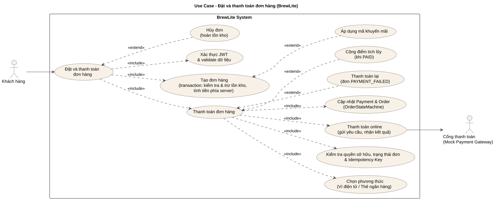

# Thanh toán đơn hàng

## 1. Thông tin chung

| Thuộc tính | Nội dung |
|---|---|
| Tên | Thanh toán đơn hàng |
| Actor chính | Khách hàng |
| Actor phụ | VNPay Sandbox |
| Mục tiêu | Thanh toán một đơn hàng bằng ví QR mô phỏng, thẻ mô phỏng hoặc VNPay Sandbox; nhận kết quả và tránh xử lý giao dịch trùng lặp. Các giao dịch chỉ phục vụ mục đích thử nghiệm, không sử dụng tiền thật. |

## 2. Sơ đồ Use Case

## 3. Tiền điều kiện

1. Khách đã đăng nhập, phiên JWT hợp lệ. Backend chỉ chấp nhận thanh toán cho đơn thuộc đúng chủ sở hữu.
2. Khách có món trong giỏ hàng và nhấn đặt hàng.
3. Đơn hàng được tạo thành công; đơn ở trạng thái `PENDING` hoặc `PAYMENT_FAILED`, không bị hủy và chưa quá hạn.

## 4. Trigger

Khách nhấn **Xác nhận thanh toán** ở trang thanh toán sau khi chọn phương thức và hoàn thành các kiểm tra tương ứng.

## 5. Luồng chính – Thanh toán thành công (MOCK)

| Bước | Khách hàng | Hệ thống |
|---|---|---|
| 1 | Khách hàng xem giỏ hàng và số tiền cần trả dự kiến. | |
| 2 | Chọn `WALLET` hoặc `CARD`. Với ví, bấm **Kiểm tra giao dịch** để xác nhận giả lập; với thẻ, nhập và xác thực dữ liệu thẻ. | |
| 3 | Nhấn **Xác nhận thanh toán**. Nếu chưa có `pendingOrder`, frontend gọi `POST /orders` (có thể kèm mã giảm giá). | API tạo Order theo dữ liệu giỏ hàng; ghi `orderId`, `orderCode`, tổng tiền phía server; đơn ở trạng thái `PENDING`. |
| 4 | Sinh `Idempotency-Key` rồi gọi `POST /payments`, gửi `orderId`, `method` và JWT. | API xác thực JWT và chủ đơn, kiểm tra DTO, đơn tồn tại, thời hạn và trạng thái đơn. |
| 5 | — | Tra cứu giao dịch có cùng `(userId, orderId, idempotencyKey)`; nếu chưa tồn tại thì tiếp tục. |
| 6 | — | Thanh toán thành công; trong transaction cập nhật Order `PENDING → PAID` (hoặc `PAYMENT_FAILED → PENDING → PAID` khi thử lại), lưu Payment `PAID` với số tiền từ Order. |
| 7 | — | Sau khi transaction thành công, hệ thống ghi điểm thưởng theo đơn. |
| 8 | Nhận kết quả thành công, xóa giỏ và hiển thị mã đơn, số tiền, trạng thái. | Trả Payment, `orderStatus = PAID` và cờ `reused = false`. |

## 6. Luồng thay thế

### AF-01 – Thanh toán bằng ví QR mô phỏng

Sau khi chọn Thanh toán bằng ví QR, giao diện hiển thị mã QR mẫu và nút **Kiểm tra giao dịch**. Nút này chỉ đổi trạng thái xác nhận trên giao diện; không kiểm tra với MoMo/ZaloPay/ngân hàng. Sau khi xác nhận, người dùng có thể gửi yêu cầu thanh toán.

### AF-02 – Thanh toán bằng thẻ mô phỏng

Sau khi chọn Thanh toán bằng thẻ, khách hàng nhập thông tin thẻ. Frontend kiểm tra thông tin bằng `validateCard()`. Nếu hợp lệ, người dùng có thể gửi yêu cầu thanh toán.

### AF-03 – Thanh toán thất bại và thử lại

Nếu trạng thái Order là `PAYMENT_FAILED`, giao diện hiển thị nút thử lại. Khách chọn thử lại trên đơn hàng cũ, frontend sinh `Idempotency-Key` mới và gửi yêu cầu lần nữa.

Nếu thanh toán thành công, Order chuyển `PAYMENT_FAILED → PENDING → PAID`. Mỗi lần thử lại tạo một giao dịch Payment mới, không tạo lại Order và không trừ tồn kho thêm lần nữa.

Đối với VNPay, lần thanh toán lại sử dụng mã giao dịch `vnp_TxnRef` mới.

### AF-04 – Gửi lại cùng Idempotency-Key

Nếu Payment đã tồn tại với cùng khóa, API trả kết quả đã lưu (`reused = true`); không tạo Payment mới.

Với các yêu cầu đồng thời, hệ thống có thêm điều kiện cập nhật trạng thái và khóa duy nhất ở database để tránh ghi nhận hai lần.

Đối với VNPay, nếu Payment đang ở trạng thái `INITIATED`, hệ thống trả lại thông tin giao dịch đã khởi tạo thay vì tạo giao dịch VNPay mới với cùng khóa.

### AF-05 – Hủy đơn chưa thanh toán

Khách hàng có thể hủy đơn ở trạng thái `PENDING` hoặc `PAYMENT_FAILED` thông qua `POST /orders/:id/cancel`.

Backend kiểm tra quyền sở hữu và trạng thái đơn, sau đó chuyển Order sang `CANCELLED`, ghi lý do hủy và hoàn lại tồn kho/nguyên liệu theo quy tắc.

Đối với thanh toán VNPay, hệ thống cần kiểm tra giao dịch đang chờ xác nhận trước khi cho phép hủy đơn, tránh trường hợp đơn bị hủy trong khi giao dịch thanh toán vẫn đang được xử lý.

### AF-06 – Có mã khuyến mãi

Khách nhập mã trong trang thanh toán. Giao diện kiểm tra mã qua `POST /promotions/validate`; khi tạo Order, `promoCode` được gửi lên backend và được kiểm tra/tính lại ở phía server.

Việc áp mã không làm thay đổi cách `POST /payments` lấy tổng tiền từ Order.

### AF-07 – Thanh toán qua VNPay Sandbox

1. Khách hàng chọn phương thức thanh toán `VNPAY` và nhấn **Xác nhận thanh toán**.
2. Nếu chưa có đơn hàng, frontend gọi `POST /orders` để tạo Order ở trạng thái `PENDING`.
3. Frontend sinh `Idempotency-Key` và gửi `POST /payments` với `orderId`, `method = VNPAY` và JWT.
4. Backend xác thực JWT, kiểm tra quyền sở hữu, thời hạn và trạng thái Order, đồng thời kiểm tra Idempotency-Key.
5. Nếu yêu cầu hợp lệ, backend tạo Payment `INITIATED`, sinh mã giao dịch `vnp_TxnRef` và tạo URL thanh toán VNPay Sandbox có chữ ký.
6. Backend trả URL thanh toán; frontend chuyển hướng khách hàng đến trang VNPay Sandbox.
7. Khách hàng thực hiện thanh toán thử nghiệm trên VNPay Sandbox.
8. VNPay gửi thông báo kết quả qua IPN. Backend xác thực chữ ký, mã giao dịch, số tiền và trạng thái thanh toán.
9. Nếu thanh toán thành công, backend cập nhật Payment `INITIATED → PAID` và Order `PENDING → PAID` trong transaction, đồng thời ghi nhận điểm thưởng theo đơn.
10. Nếu thanh toán thất bại, backend cập nhật Payment `INITIATED → FAILED` và Order `PENDING → PAYMENT_FAILED`, cho phép khách thử lại.
11. VNPay chuyển hướng khách hàng về Return URL. Frontend truy vấn trạng thái thanh toán đã được backend xác nhận.
12. Nếu thanh toán thành công, frontend xóa giỏ hàng và hiển thị mã đơn, số tiền, trạng thái. Nếu chưa có kết quả xác nhận, giao diện thông báo đang chờ xử lý, với Payment `INITIATED` và Order `PENDING`.

## 7. Ngoại lệ

| Mã | Tình huống | Kết quả |
|---|---|---|
| EF-01 | Thiếu JWT hoặc token hết hạn | HTTP `401`; không cho phép tiếp tục thanh toán |
| EF-02 | Đơn thuộc người khác | HTTP `403`; không cho phép tiếp tục thanh toán |
| EF-03 | `orderId` không tồn tại | HTTP `404`; không tạo Payment |
| EF-04 | Thiếu `Idempotency-Key`, khóa quá 64 ký tự, header/body không khớp hoặc DTO sai | HTTP `400`; không tạo Payment |
| EF-05 | Đơn đã `PAID`, `CANCELLED` hoặc trạng thái khác không thể thanh toán với key mới | HTTP `409`; không tạo Payment mới |
| EF-06 | Đơn chưa thanh toán quá hạn | `OrdersService` chuyển Order sang `CANCELLED`, hoàn kho và `POST /payments` trả `409` |
| EF-07 | Hai giao dịch đồng thời cạnh tranh trạng thái Order | Một giao dịch có thể thắng; yêu cầu còn lại bị từ chối hoặc trả bản ghi cũ nếu cùng key (sử dụng optimistic lock + transaction) |
| EF-08 | Backend cấu hình provider không được hỗ trợ hoặc provider chưa được cấu hình | HTTP `503`; không khởi tạo thanh toán |
| EF-09 | VNPay thông báo giao dịch thanh toán thất bại | Ghi nhận Payment `FAILED`, Order `PAYMENT_FAILED`; khách có thể thử lại |
| EF-10 | IPN VNPay có chữ ký không hợp lệ, sai số tiền hoặc thông tin giao dịch không khớp | Backend từ chối cập nhật Payment và Order; trả mã phản hồi IPN phù hợp |
| EF-11 | VNPay chưa gửi IPN hoặc giao dịch đang chờ xác nhận | Giữ Payment `INITIATED` và Order `PENDING`; frontend hiển thị thông báo đang chờ xác nhận |
| EF-12 | VNPay gửi lại IPN của giao dịch đã được xử lý | Backend kiểm tra trạng thái hiện tại, không cập nhật hoặc ghi nhận thanh toán lần thứ hai |
| EF-13 | Khách đóng trang VNPay hoặc quay lại website trước khi giao dịch được xác nhận | Không tự động đánh dấu thanh toán thành công hoặc thất bại; hệ thống hiển thị trạng thái hiện tại của giao dịch |
| EF-14 | VNPay gửi kết quả thanh toán sau khi Order đã chuyển sang `CANCELLED` | Backend không tự động chuyển Order sang `PAID`; ghi nhận hoặc xử lý giao dịch theo quy tắc đối soát, tránh cập nhật sai trạng thái đơn hàng |

## 8. Hậu điều kiện

- **Thành công:** `Payment = PAID`, `Order = PAID`; hiển thị thành công, xóa giỏ hàng và ghi nhận điểm thưởng.
- **Thất bại:** `Payment = FAILED`, `Order = PAYMENT_FAILED`; khách có thể thử lại hoặc hủy đơn.
- **Bị từ chối:** Không tạo Payment mới; Order giữ nguyên trạng thái hoặc chuyển sang `CANCELLED` nếu khách chủ động hủy đơn hoặc đơn quá hạn thanh toán.
- **Gửi lại key cũ:** Không tạo lần thanh toán khác; trả lại kết quả hoặc thông tin giao dịch đã ghi nhận.
- **Đang chờ xác nhận VNPay:** `Payment = INITIATED`, `Order = PENDING`; chưa ghi nhận thanh toán thành công, chưa cộng điểm thưởng và chưa xóa giỏ hàng.
- **IPN trùng lặp:** Không cập nhật trạng thái hoặc ghi nhận thanh toán nhiều lần cho cùng một giao dịch.
- **Đơn hàng bị hủy:** `Order = CANCELLED`; không tiếp nhận yêu cầu thanh toán mới. Việc hoàn tồn kho/nguyên liệu được thực hiện theo quy tắc hủy đơn.
- **Admin hủy đơn đã thanh toán:** `Order = CANCELLED`, Payment đã `PAID` vẫn được giữ nguyên để lưu lịch sử giao dịch. Việc xử lý hoàn tiền (nếu có) thuộc nghiệp vụ quản lý đơn hàng.
